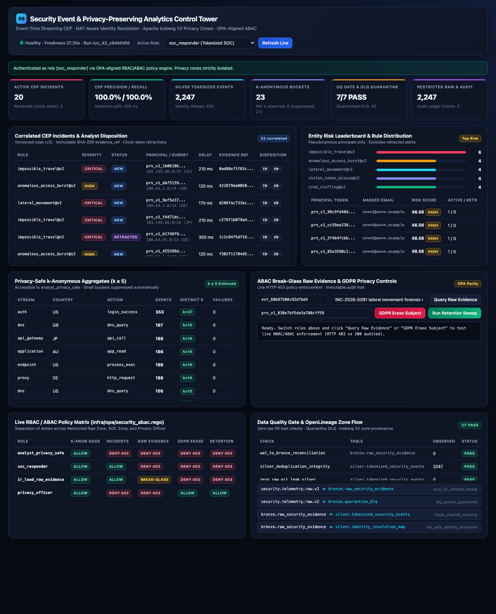

# Technical Appendix: Ablations, Acceptance Matrix, Chaos Drills & Governance

This appendix holds detailed experimental ablations, full acceptance-test verification, chaos engineering outputs, RBAC/ABAC enforcement matrices, and compliance disclosures referenced from `README.md`.

## 1. Full NAT-Naive (`v1`) vs. NAT-Aware (`v2`) Detection Ablation

All measurements were collected from `benchmarks/run_benchmarks.py` (`results/benchmarks/nat_ablation.csv`) on identical seeded multi-source telemetry (`seed=42`, Apple M4 Pro, `local_native`):

| Profile | Ruleset | Ground-Truth Campaigns | Active Alerts | Retracted Alerts | TP | FP | FN | Precision | Recall | F1 | FP Rate |
| :--- | :--- | ---: | ---: | ---: | ---: | ---: | ---: | ---: | ---: | ---: | ---: |
| `smoke` | `v1` NAT-Naive (no retraction) | 10 | 15 | 0 | 10 | 5 | 0 | 66.7% | 100.0% | 80.0% | 33.3% |
| `smoke` | **`v2` NAT-Aware + Retract** | 10 | 10 | 1 | 10 | **0** | 0 | **100.0%** | **100.0%** | **100.0%** | **0.0%** |
| `local` | `v1` NAT-Naive (no retraction) | 40 | 49 | 0 | 40 | 8 | 0 | 83.3% | 100.0% | 90.9% | 16.3% |
| `local` | **`v2` NAT-Aware + Retract** | 40 | 40 | 4 | 40 | **0** | 0 | **100.0%** | **100.0%** | **100.0%** | **0.0%** |
| `stress` | `v1` NAT-Naive (no retraction) | 40 | 49 | 0 | 40 | 8 | 0 | 83.3% | 100.0% | 90.9% | 16.3% |
| `stress` | **`v2` NAT-Aware + Retract** | 40 | 40 | 4 | 40 | **0** | 0 | **100.0%** | **100.0%** | **100.0%** | **0.0%** |

### Why False Positives Occurred in `v1` and How `v2` Resolved Them
1. **Shared Corporate NAT Gateways:** Two corporate egress gateways (`198.51.100.10`, `203.0.113.25`) aggregate 28 benign employees experiencing expired SSO sessions. `cred_stuffing@v1` grouped strictly by `ip_token`, generating false credential-stuffing alerts. `cred_stuffing@v2` checks `nat_egress_flag` and prevents `IdentityResolver` from ever using `source_ip` as an identity join key.
2. **Workstation Clock Skew:** Unsynchronized laptops (`clock_skew_ms = -10_800_000`) made sequential `GB -> DE` logins appear 20 minutes apart (~1,965 km/h). `impossible_travel@v2` reconciles delayed NTP/MFA confirmation events (`is_retraction_evidence=True`), transitioning speculative alerts to `RETRACTED` and zeroing their entity risk weight.
3. **Engineering Fix Discovered During Vertical Slice Testing:** Early testing revealed `lateral_movement@v2` re-firing when benign events for an already-compromised principal crossed a 900s dedup bucket boundary, causing 3 extra alerts and inflated p95 detection delay (`785s`). Guarding evaluation strictly on stage-matching events (`auth jumpbox` / `endpoint suspicious exec` / `dns|proxy beacon`), anchoring dedup buckets on `chain_start`, and computing `detection_delay_ms` from the triggering event resolved the issue (`active_incidents = 20 == 20 campaigns`, p95 delay `300 ms`).

## 2. Bounded State Scaling & Iceberg V2 Compaction Details

### Bounded CEP State Scaling (`max_dedup_ids=3000`, `max_entity_keys=500`, cap=`5,500`)

| Input Events | Peak Active State Entries | Hard Eviction Cap | Throughput (ev/s) |
| ---: | ---: | ---: | ---: |
| 1,545 | 1,669 | 5,500 | 43,210.1 |
| 4,553 | 3,290 | 5,500 | 42,568.4 |
| 10,857 | 3,299 | 5,500 | 43,048.7 |
| 21,363 | **3,301** | 5,500 | **43,249.7** |

### Apache Iceberg V2 Compaction (`silver.tokenized_security_events`, 24 Micro-Batches)

| Metric | Before Compaction | After Compaction | Improvement |
| :--- | ---: | ---: | :--- |
| Parquet Data Files | 26 | **2** | **-92.3%** |
| Median Full Scan Latency | 32.598 ms | **4.097 ms** | **7.96x faster** |
| Median DuckDB Group-By Query | 10.101 ms | 9.464 ms | -6.3% |
| Compaction Wall Time | — | 47.880 ms | — |

## 3. Automated Chaos & Fault-Injection Drills (8/8 Passed)

Backed by `tests/chaos/test_chaos_drills.py` and raw evidence in `results/chaos/chaos_results.json`:

| Drill ID | Adversarial Scenario | Key Measured Outcome | Status |
| :--- | :--- | :--- | :---: |
| `drill_01` | Credential stuffing + shared corporate NAT login storm | `v1` FP=`4` (`83.3%` prec) vs `v2` FP=`0` (`100.0%` prec, `100.0%` rec) | **PASS** |
| `drill_02` | Clock-skewed impossible travel + late NTP/MFA retraction | `2` alerts transitioned to `RETRACTED`; entity risk zeroed | **PASS** |
| `drill_03` | Unauthorized raw-evidence & unjustified break-glass probing | `401` unauth; `403` analyst/SOC/privacy/unjustified IR; `200` justified IR; `5` denial audits logged | **PASS** |
| `drill_04` | GDPR Article 17 crypto-shredding & subject purge | Vault key `SHREDDED`; `0` rows left in bronze/silver/identity map; `19` k-anon buckets preserved | **PASS** |
| `drill_05` | 7-day retention TTL expiration sweep | `15` aged raw rows purged (`0` expired left); `1,213` fresh rows retained; audited | **PASS** |
| `drill_06` | Mid-stream consumer crash + wiped Silver/Gold tables | WAL replay recovered `1,364/1,364` silver rows & identical incident IDs | **PASS** |
| `drill_07` | Malformed poison payload flood (bad IP/coords/stream/IDs) | `39/39` quarantined to `bronze.quarantine_dlq`; `1,160` valid processed; `7/7` DQ pass | **PASS** |
| `drill_08` | 3x at-least-once duplicate storm (`+600` duplicate events) | `634` deduplicated; `1,160 == 1,160` silver rows; `10 == 10` active incidents | **PASS** |

## 4. RBAC / ABAC Policy & Separation-of-Duties Matrix (`infra/opa/security_abac.rego`)

| Role | `/v1/aggregates/privacy-safe` (`k >= 5`) | `/v1/incidents` & `/v1/entities/risk` | `/v1/evidence/raw/{event_id}` | `/v1/privacy/erase/{token}` | `/v1/privacy/retention-sweep` | `/v1/audit` |
| :--- | :---: | :---: | :---: | :---: | :---: | :---: |
| `analyst_privacy_safe` | ALLOW | DENY (403) | DENY (403) | DENY (403) | DENY (403) | DENY (403) |
| `soc_responder` | ALLOW | ALLOW | DENY (403) | DENY (403) | DENY (403) | DENY (403) |
| `ir_lead_raw_evidence` | ALLOW | ALLOW | **ALLOW + X-Justification (>=12 chars) + Audit** | DENY (403) | DENY (403) | ALLOW |
| `privacy_officer` | ALLOW | DENY (403) | DENY (403) | **ALLOW + Audit** | **ALLOW + Audit** | ALLOW |

## 5. Mandatory Acceptance Test Matrix (15/15 Verified)

| # | Acceptance Requirement | Verification Proof & Artifact | Status |
| :---: | :--- | :--- | :---: |
| 1 | Fresh-clone setup starts core stack & verifies health | `./scripts/run_portable.sh`; `GET http://127.0.0.1:8080/health` returns `200` with table counts & freshness | **PASS** |
| 2 | Deterministic generation yields identical IDs & outcomes per seed | `test_deterministic_generator_reproducibility` (`tests/unit/test_identity_and_cep.py`) | **PASS** |
| 3 | Real ingestion persists source data with metadata & replay | `DurableWalBroker` (`ingestion/wal_broker.py`) + `test_e2e_vertical_slice_and_deterministic_wal_replay` | **PASS** |
| 4 | Core domain transformation yields correct results for fixtures | `test_cep_nat_aware_reduces_false_positives_and_retracts_clock_skew` (`100%` precision/recall) | **PASS** |
| 5 | Domain-specific advanced features operational end-to-end | Streaming CEP, NAT-safe identity resolution, HMAC tokenization, k-anonymity, ABAC, GDPR erasure (`tests/integration/test_iceberg_and_api.py`) | **PASS** |
| 6 | Duplicates, late events & corrections handled without corruption | `drill_02` (clock-skew retraction), `drill_08` (3x duplicate storm) | **PASS** |
| 7 | Service crash & restart recovers per tested guarantee | `drill_06_broker_outage_wal_crash_recovery` | **PASS** |
| 8 | Backfill / replay reconciles with documented exceptions | `test_e2e_vertical_slice_and_deterministic_wal_replay` + `docs/limitations.md` | **PASS** |
| 9 | Primary API & dashboard return real computed outputs & freshness | Live `:8080` API + verified full-page screenshot (`docs/assets/secops_control_tower_full.png`) | **PASS** |
| 10 | DQ checks catch invalid inputs & retain quarantine records | `bronze.quarantine_dlq` (`30` poison rows in default run, `39` in `drill_07`) + `7/7` DQ checks in `results/quality/dq_results.json` | **PASS** |
| 11 | Observability emits real logs, metrics & trace spans | Redacting JSON logs, `/metrics` Prometheus exposition, `/v1/traces` spans, `/v1/lineage` OpenLineage export | **PASS** |
| 12 | Access control rejects unauthorized test requests | `drill_03` + `test_property_non_ir_roles_never_read_raw_evidence` (`401`/`403` enforced) | **PASS** |
| 13 | Controlled failure produces incident report with observed recovery | `docs/incidents/incident-001-nat-storm-and-broker-recovery.md` | **PASS** |
| 14 | Benchmark records hardware, volume, commands, metrics & raw outputs | `benchmarks/run_benchmarks.py` -> `results/benchmarks/*` + `docs/benchmarks/benchmark-report.md` | **PASS** |
| 15 | CI & tests execute; limitations disclosed honestly | `ruff` 0 issues, `mypy` 0 issues, `28/28` pytest passed (`results/tests/junit.xml`), `docs/limitations.md` | **PASS** |

## 6. Full-Page Live SOC & Privacy Control Tower Capture

## 7. License, Model & Compliance Record

- **Pretrained ML Models:** **None (`0` downloaded).** All threat correlation uses deterministic, inspectable event-time CEP rules (`processing/cep_engine.py`).
- **Datasets:** **100% synthetic seeded telemetry** generated locally (`ingestion/generator.py`); zero external restricted or personal datasets.
- **Dependency License Audit:** `uv run python scripts/check_licenses.py` verified **61 installed Python packages** (`0` strong-copyleft or proprietary violations; full breakdown in `results/sbom/license_audit.json`).
- **SBOM:** CycloneDX 1.5 JSON SBOM generated via `uv run python scripts/generate_sbom.py` (`results/sbom/cyclonedx_sbom.json`).
- **Container Pinning:** Every container image in `docker-compose.yml`, `infra/docker/Dockerfile.standalone`, and `infra/kubernetes/` is pinned to an explicit version tag.
