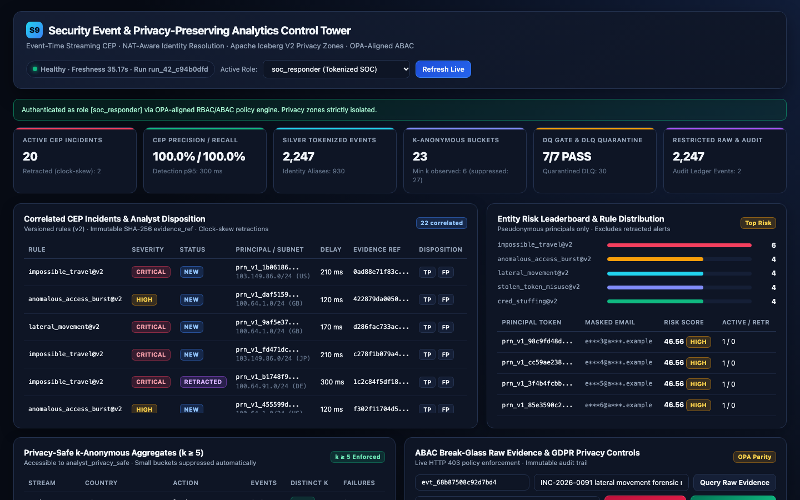
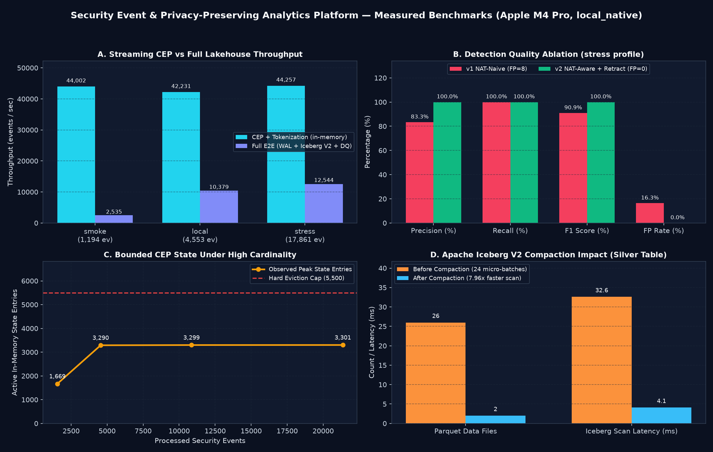

# Real-Time Security Event & Privacy-Preserving Analytics Platform

A real-time security telemetry correlation and privacy-preserving Apache Iceberg V2 lakehouse platform that detects credential stuffing, impossible travel, stolen token misuse, lateral movement, and anomalous data bursts across six log streams while enforcing strict raw-PII zone separation, OPA-aligned ABAC, k-anonymity (`k >= 5`), retention TTL windows, and GDPR Article 17 crypto-shredding. On the stress benchmark (`17,861` valid events with shared corporate NAT login storms and host clock skew), the NAT-aware `v2` CEP ruleset achieves **100.0% precision and 100.0% recall (0 false positives)** compared to **83.3% precision (8 false positives, 16.3% FP rate)** on the `v1` NAT-naive baseline, while processing **44,257 events/sec** in-memory and **12,544 events/sec** end-to-end into Iceberg V2.



## Engine, Framework & Hardware

- **Detection & Privacy Engine:** Deterministic event-time streaming CEP and multi-source interval-join engine (`processing/cep_engine.py`, PyFlink 2.1.3 job in `processing/flink/security_cep_job.py`), NAT-safe identity resolver (`processing/identity_resolver.py`), and keyed HMAC-SHA256 tokenization + per-subject crypto-shredding vault (`services/secops_platform/privacy.py`). **Zero pretrained ML model weights** are downloaded or used; all code is Apache-2.0 and all 61 Python dependencies pass automated license checks (`results/sbom/license_audit.json`).
- **Storage & Governance Stack:** Python `3.12.8` (`uv.lock`), `pyiceberg==0.12.0` (Apache Iceberg V2 across 9 zone-isolated tables), `duckdb==2.0.0`, `pyarrow==25.0.1`, `fastavro==1.13.1` (Avro v1/v2 contracts), `fastapi==0.163.2`, `uvicorn==0.54.0`, OPA Rego ABAC policy (`infra/opa/security_abac.rego`), OpenBao `2.7.3` key-rotation config (`infra/openbao/config.hcl`), and pinned multi-profile Docker Compose (`Kafka 4.3.2`, `Apicurio 3.3.5`, `Flink 2.1.3`, `Spark 4.1.4`, `OpenSearch 3.9.0`, `RustFS 1.0.6`, `Lakekeeper v0.15.1`, `OPA 1.22.3`, `OpenBao 2.7.3`, `Airflow 3.4.0`, `Prometheus v3.16.0`, `Grafana 13.0.14`, `Loki 3.6.22`, `OTel Collector 0.166.0`, `Marquez 0.51.1`).
- **Measured Hardware:** Apple M4 Pro (14 CPU cores, 48.0 GiB RAM, `Darwin 24.6.0` `arm64`), `local_native` runtime (single host, zero Docker required).

## Main Results

### 1. Streaming CEP Throughput & NAT-Naive (`v1`) vs. NAT-Aware (`v2`) Detection Quality

Measured via `benchmarks/run_benchmarks.py` on identical seeded multi-stream telemetry containing 5 attack classes, shared corporate NAT password-rotation noise, -3h host clock skew, duplicates, and malformed poison records (`results/benchmarks/benchmark_summary.json`):

| Profile | Valid Events | CEP + Tokenize (ev/s) | Full E2E WAL + Iceberg V2 + DQ (ev/s) | `v1` NAT-Naive Precision / FP | **`v2` NAT-Aware Precision / Recall / FP** | Retracted Alerts | Detection Delay p50 / p95 (ms) |
| :--- | ---: | ---: | ---: | :---: | :---: | ---: | :---: |
| `smoke` | 1,194 | 44,002 | 2,535 | 66.7% / 5 FP | **100.0% / 100.0% / 0 FP** | 1 | 190 / 300 |
| `local` | 4,553 | 42,231 | 10,379 | 83.3% / 8 FP | **100.0% / 100.0% / 0 FP** | 4 | 190 / 300 |
| `stress` | 17,861 | **44,257** | **12,544** | 83.3% / 8 FP | **100.0% / 100.0% / 0 FP** | 4 | 190 / 300 |

### 2. Iceberg V2 Compaction, Bounded State & Privacy/Chaos Verification

| Verification Area | Baseline / Condition | Measured Result | Evidence Artifact |
| :--- | :--- | :--- | :--- |
| **Iceberg V2 Compaction** (`silver.tokenized_security_events`) | 24 micro-batch appends (26 Parquet files, `32.6 ms` median scan) | **2 Parquet files (-92.3%), `4.1 ms` scan (7.96x faster)** | `results/benchmarks/iceberg_compaction.json` |
| **Bounded CEP State Scaling** | 1,545 -> 21,363 events (13.8x volume growth, 5,500 eviction cap) | Peak state plateaus at **3,301 entries** (`43,250 ev/s`) | `results/benchmarks/benchmark_summary.json` |
| **Privacy & ABAC Controls** | 4 roles (`analyst_privacy_safe`, `soc_responder`, `ir_lead_raw_evidence`, `privacy_officer`) | **0 raw PII leaks**, `min k >= 5`, real **HTTP 401/403**, audited break-glass & GDPR crypto-shredding (`0` rows remaining) | `results/chaos/chaos_results.json` |
| **Automated Test & Chaos Suite** | Unit, Hypothesis property, Avro v1/v2 contracts, Integration, E2E, Perf, 8 Chaos Drills | **28/28 pytest passed**, **8/8 chaos drills passed**, **7/7 DQ checks passed**, `ruff` & `mypy` clean | `results/tests/junit.xml` |



## How to Run on Any Machine (Step-by-Step)

### Option A: Zero-Docker Local Native Runner (macOS ARM64 / Intel / Linux)

Requires only [`uv`](https://docs.astral.sh/uv/) and Python 3.12 (no Docker, no JVM):

```bash
git clone https://github.com/rohanluniya/security-event-privacy-analytics.git
cd security-event-privacy-analytics

# One-command bootstrap: syncs locked Python 3.12 env, runs deterministic WAL -> CEP -> Iceberg V2 pipeline, starts live API + Dashboard on :8080
./scripts/run_portable.sh
```

Or run step-by-step with `make`:

```bash
make setup        # uv sync --frozen --python 3.12.8
make pipeline     # Deterministic 3,000-event telemetry -> WAL -> CEP -> 9 Iceberg V2 tables -> DQ gate
make serve        # Starts FastAPI Control Plane + SOC Dashboard on http://127.0.0.1:8080
```

Verify live health, RBAC/ABAC enforcement, and metrics in a second terminal:

```bash
curl -s http://127.0.0.1:8080/health
# Expect HTTP 401 without API key:
curl -s -o /dev/null -w "%{http_code}\n" http://127.0.0.1:8080/v1/incidents
# Expect HTTP 403 when analyst_privacy_safe queries restricted raw evidence:
curl -s -o /dev/null -w "%{http_code}\n" -H "X-API-Key: secops-dev-analyst-key" http://127.0.0.1:8080/v1/evidence/raw/evt_example
# Expect HTTP 200 for privacy-safe k-anonymous aggregates (k >= 5):
curl -s -H "X-API-Key: secops-dev-analyst-key" http://127.0.0.1:8080/v1/aggregates/privacy-safe
```

### Option B: Standalone Single-Container Docker

```bash
docker compose -f docker-compose.standalone.yml up --build
```

### Option C: Full Distributed Multi-Profile Stack (Kafka, Flink, Spark, Iceberg/Lakekeeper, OPA, OpenBao, Observability)

```bash
# Start core plane (API, Kafka 4.3.2, Apicurio, OPA 1.22.3, OpenBao 2.7.3, RustFS, Lakekeeper, PostGIS)
docker compose --profile core up -d

# Or launch all profiles (core + Flink + Spark + OpenSearch + Airflow + Prometheus + Grafana + Loki + OTel + Marquez)
docker compose --profile full up -d
```

### Reproduce Tests, Chaos Drills & Benchmarks

```bash
make verify-all   # ruff + mypy + license audit + CycloneDX SBOM + all 28 pytest tests (including 8 chaos drills)
make bench        # Runs smoke/local/stress benchmarks, NAT ablation, compaction benchmark, and regenerates PNG chart
```

## Detailed Analysis, Architecture & Raw Evidence

- **[APPENDIX.md](APPENDIX.md):** Full NAT-naive vs. NAT-aware ablation tables, bounded-state scaling details, 15-item Mandatory Acceptance Test Matrix, all 8 Chaos Drills, RBAC/ABAC separation-of-duties matrix, and license/privacy disclosures.
- **[docs/architecture/system-architecture.md](docs/architecture/system-architecture.md) & ADRs (`docs/architecture/adr-*.md`):** Privacy-zone diagrams, event-time sequence flows, and architectural decision records.
- **[docs/benchmarks/benchmark-report.md](docs/benchmarks/benchmark-report.md) & `results/`:** Raw JSON/CSV benchmark outputs, chaos drill reports, DQ gate results, OpenLineage graph, license audit, CycloneDX SBOM, and JUnit XML.
- **[docs/threat-model.md](docs/threat-model.md), [docs/demo-script.md](docs/demo-script.md), [docs/limitations.md](docs/limitations.md):** STRIDE analysis, 5-minute interactive walkthrough, and explicit dev-vs-production limitations.
