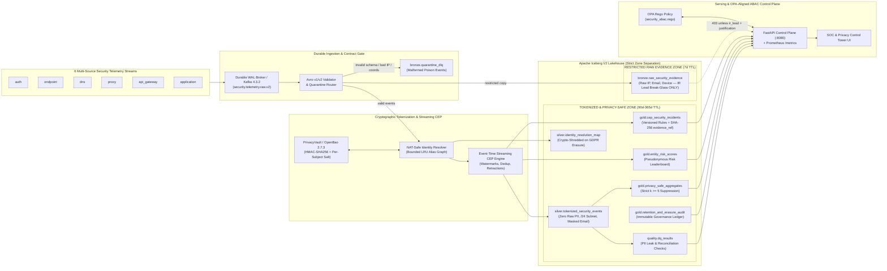
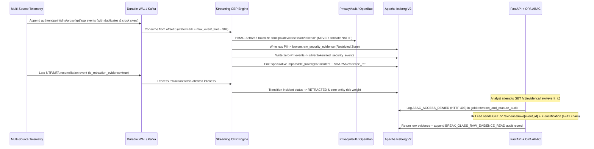

# System Architecture & Privacy Zone Isolation

## 1. Component & Privacy-Zone Diagram

## 2. Event-Time Correlation, Clock-Skew Retraction & Break-Glass Sequence

## 3. Failure-Domain & Consistency Boundaries

| Boundary | Delivery / Consistency Guarantee | Recovery Mechanism |
| :--- | :--- | :--- |
| Telemetry -> WAL Broker | At-least-once durable append (`fsync` per batch) | Producer retries absorbed downstream by `event_id` deduplication |
| WAL -> CEP Engine | Effectively-once business state via deterministic `event_id` dedup + deterministic `incident_id` upsert | Replay from WAL offset `0` reproduces identical Silver rows and Gold incident IDs |
| CEP -> Apache Iceberg V2 | Atomic snapshot commits (`append` / `overwrite`) | Time-travel rollback via Iceberg snapshot history |
| GDPR Erasure | Atomic per-subject salt destruction + table rewrites + immutable audit append | Re-running erasure for an already-shredded token is idempotent and returns `0` remaining rows |
| ABAC Policy Check | Fail-closed (`default allow := false`) | Missing OPA sidecar falls back only to identical embedded Rego-parity evaluator (never fail-open) |
