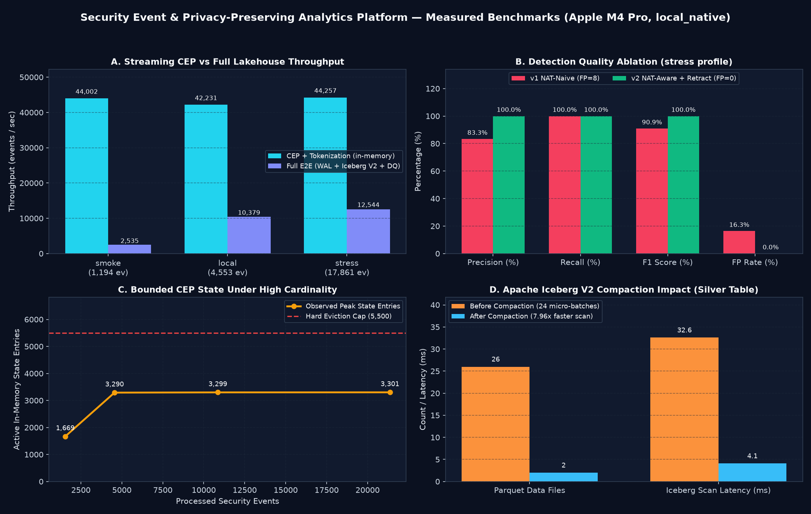

# Benchmark Report: Streaming CEP, NAT Ablation, Bounded State & Iceberg V2 Compaction

All numbers below are 100% measured outputs recorded in `results/benchmarks/benchmark_summary.json`, `results/benchmarks/benchmark_profiles.csv`, `results/benchmarks/nat_ablation.csv`, and `results/benchmarks/iceberg_compaction.json`.

## 1. Hardware & Software Environment

- **Hardware:** Apple M4 Pro (14 CPU cores, 48.0 GiB RAM), `Darwin 24.6.0` (`arm64`)
- **Runtime:** `local_native`, Python `3.12.8`, `pyiceberg==0.12.0`, `duckdb==2.0.0`, `pyarrow==25.0.1`, `fastavro==1.13.1`
- **Reproduce Command:** `uv run python benchmarks/run_benchmarks.py --profiles smoke local stress`

## 2. Throughput & Latency Across Profiles (NAT-Aware `v2` Ruleset)

| Profile | Valid Events | DLQ Quarantined | CEP + Tokenize (ev/s) | Full E2E WAL + Iceberg V2 + DQ (ev/s) | Detection Delay p50 / p95 / p99 (ms) | Per-Event CPU p95 (ms) | DQ Gate |
| :--- | ---: | ---: | ---: | ---: | :---: | ---: | :---: |
| `smoke` | 1,194 | 15 | 44,001.9 | 2,535.4 | 190.0 / 300.0 / 300.0 | 0.004 | 7/7 |
| `local` | 4,553 | 60 | 42,230.9 | 10,379.3 | 190.0 / 300.0 / 300.0 | 0.006 | 7/7 |
| `stress` | 17,861 | 250 | **44,257.3** | **12,544.2** | 190.0 / 300.0 / 300.0 | 0.004 | 7/7 |

*Setup note: `smoke` E2E throughput reflects fixed per-run Iceberg SQLite catalog table/snapshot commit overhead (~380 ms across 9 tables), which amortizes cleanly at `local` (10.4k ev/s) and `stress` (12.5k ev/s) volumes.*

## 3. NAT-Naive (`v1`) vs. NAT-Aware + Clock-Skew Retraction (`v2`) Ablation

| Profile | Ruleset | Campaigns | Active Alerts | Retracted | TP | FP | FN | Precision | Recall | F1 | FP Rate |
| :--- | :--- | ---: | ---: | ---: | ---: | ---: | ---: | ---: | ---: | ---: | ---: |
| `smoke` | `v1` NAT-Naive | 10 | 15 | 0 | 10 | 5 | 0 | 66.7% | 100.0% | 80.0% | 33.3% |
| `smoke` | **`v2` NAT-Aware + Retract** | 10 | 10 | 1 | 10 | **0** | 0 | **100.0%** | **100.0%** | **100.0%** | **0.0%** |
| `local` | `v1` NAT-Naive | 40 | 49 | 0 | 40 | 8 | 0 | 83.3% | 100.0% | 90.9% | 16.3% |
| `local` | **`v2` NAT-Aware + Retract** | 40 | 40 | 4 | 40 | **0** | 0 | **100.0%** | **100.0%** | **100.0%** | **0.0%** |
| `stress` | `v1` NAT-Naive | 40 | 49 | 0 | 40 | 8 | 0 | 83.3% | 100.0% | 90.9% | 16.3% |
| `stress` | **`v2` NAT-Aware + Retract** | 40 | 40 | 4 | 40 | **0** | 0 | **100.0%** | **100.0%** | **100.0%** | **0.0%** |

## 4. Bounded CEP State Scaling (`max_cap = 5,500`)

| Input Events | Peak In-Memory State Entries | Hard Eviction Cap | Throughput (ev/s) |
| ---: | ---: | ---: | ---: |
| 1,545 | 1,669 | 5,500 | 43,210.1 |
| 4,553 | 3,290 | 5,500 | 42,568.4 |
| 10,857 | 3,299 | 5,500 | 43,048.7 |
| 21,363 | **3,301** | 5,500 | **43,249.7** |

## 5. Apache Iceberg V2 Compaction Before vs. After (`silver.tokenized_security_events`)

Simulating 24 micro-batch streaming appends (`4,553` tokenized rows across 2 `event_date` partitions):

| Metric | Before Compaction | After Compaction | Delta vs. Uncompacted Baseline |
| :--- | ---: | ---: | :--- |
| Parquet Data Files | 26 | **2** | **-92.3%** fewer files |
| Median Iceberg Full Scan Latency | 32.598 ms | **4.097 ms** | **7.96x faster** |
| Median DuckDB Group-By Query Latency | 10.101 ms | 9.464 ms | -6.3% (in-memory Arrow scan) |
| Compaction Wall Time | — | 47.880 ms | Paid once per maintenance window |
